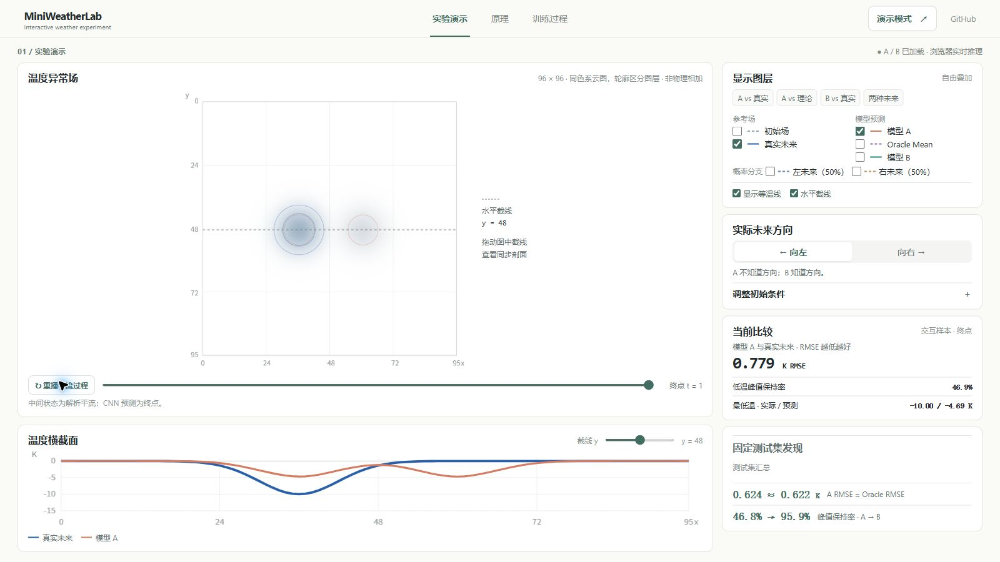

# MiniWeatherLab

*When Optimal Predictions Miss the Extremes*

如果一个 AI 的预测已经接近数学意义上的最优，为什么它还是会把最强的低温异常预测弱一半？

MiniWeatherLab 是为《大气科学基础》课程制作的一个小型机器学习实验。我们训练了两个 CNN，观察预测信息、平均误差与局部极值之间的关系。

## 在线体验

**Live Demo：尚未发布。** 预计地址为 `https://zhuzai-2007.github.io/MiniWeatherLab/`；部署成功并验证后将在此添加链接。



## 这是什么实验？

同一个初始温度异常场可能向左或向右平移，两种未来各占 50%。

- **A** 不知道方向，只能给出一个预测。
- **B** 知道方向，再给出预测。
- **C** 展示由实验设定直接给出的两个理论概率分支。

还有一个 **Oracle Mean**：两种未来的平均，是这个设定下单值预测在均方误差（MSE）意义上的理论最优解。

## 发现了什么？

以下是一次训练在**独立测试集**上的结果；峰值保持率比较预测与真实场中低温极值的幅度。

| 预测 | RMSE | 峰值保持率 |
| --- | ---: | ---: |
| A：方向未知 | 0.624 K | 46.8% |
| Oracle Mean | 0.622 K | 50.0% |
| B：方向已知 | 0.048 K | 95.9% |

A 的整体误差接近理论最优，但低温峰值明显变弱。B 与 A 使用相同的 CNN 主体，优势来自额外提供的方向信息，不能归功于架构差异。平均误差和峰值保持衡量的是不同方面：例如，固定盲猜方向可以保留峰值幅度，却可能把峰值放在错误的位置。

## 如何使用？

发布后打开 Live Demo 即可。**实验演示**中可以切换未来方向、叠加图层并查看温度剖面；**原理**介绍实验与卷积；**训练过程**展示真实训练日志和保存的预测快照。

本地查看时，在项目根目录运行：

```sh
node web/serve.mjs
```

然后访问 `http://localhost:8000`。也可运行 `python -m http.server 8000 --directory web`。请通过本地 HTTP 服务打开网页；A、B 模型在浏览器内推理，不需要在线 API。

## 实现与复现

数据由程序合成：在 96 × 96 周期网格上生成高斯低温异常，再向左右各平移 12 格。按初始场划分训练、验证和测试集，避免同一初始场的两个分支跨分区。两个模型采用相同的编码器—解码器 CNN，在 PyTorch 中以 MSE 训练。

这次运行使用 NVIDIA GeForce RTX 5070 Ti Laptop GPU、PyTorch 2.11.0+cu128 和 CUDA 12.8；训练 18 epochs，记录的训练与评估时间约 94.7 秒。环境、依赖安装、训练参数和测试说明见 [实验与复现](docs/experiment.md)。

## 科学边界

这是理想化平流实验，不是真实天气预报系统。它检验信息不足时确定性 MSE 回归可能产生的条件平均和平滑现象，不能据此确定现实全球天气模型低估破纪录极端事件的全部原因。C 是理论概率基线，不是训练的扩散模型；它展示两种可能，也不预测哪一种实际发生。

## 参考资料与许可

- Lam et al. (2023), “Learning skillful medium-range global weather forecasting,” *Science* 382, 1416–1421. [doi:10.1126/science.adi2336](https://doi.org/10.1126/science.adi2336).
- Zhang, Fischer, Zscheischler & Engelke (2026), “Physics-based models outperform AI weather forecasts of record-breaking extremes,” *Science Advances* 12, eaec1433. [doi:10.1126/sciadv.aec1433](https://doi.org/10.1126/sciadv.aec1433).

项目自身采用 [MIT License](LICENSE)。网页使用的第三方 ONNX Runtime Web 及其许可见 [第三方声明](docs/third-party.md)。实验图表和网页截图由本项目生成。
